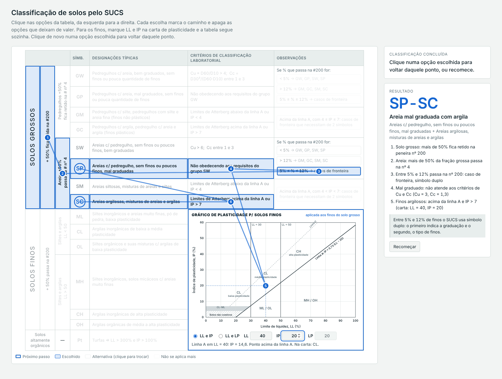
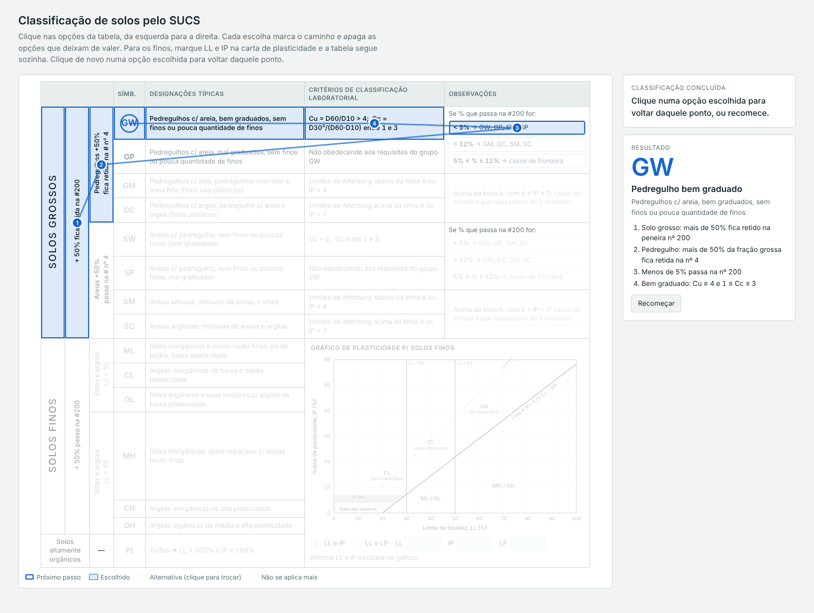
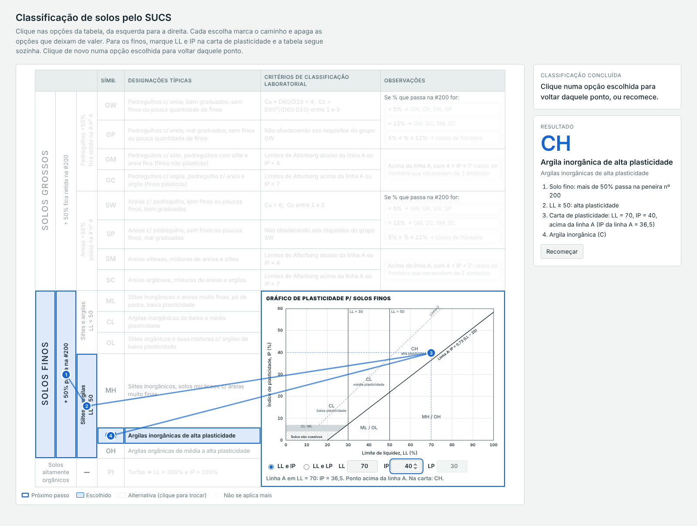
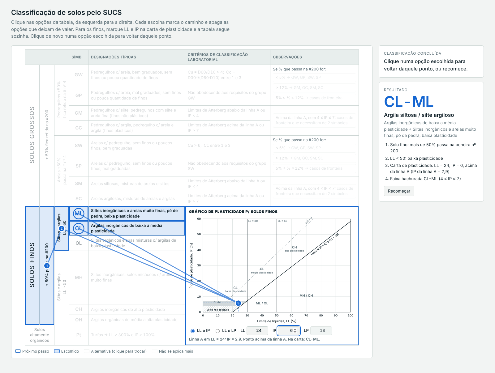
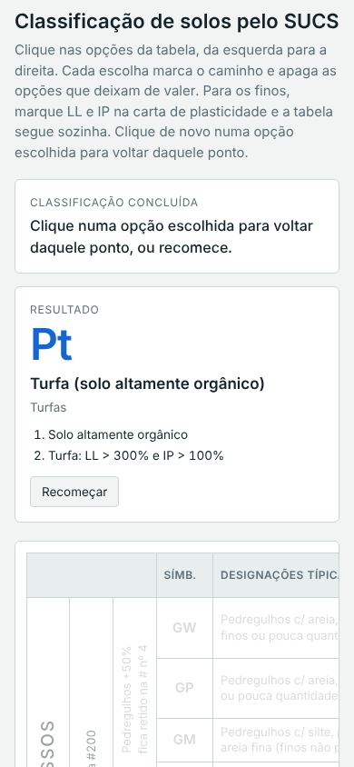

# Classificação de Solos pelo SUCS

Ferramenta de geotecnia que transforma a **tabela de classificação do SUCS** (Sistema Unificado de Classificação de Solos, ASTM D2487) em um passo a passo clicável. A cada escolha, a tabela marca o caminho percorrido, apaga as opções que deixam de valer e, no fim, mostra o símbolo do solo com a justificativa.

É um único arquivo HTML: abra com duplo clique no navegador, sem instalar nada.

**Demonstração online:** https://victortlacerda.github.io/classificacao-sucs/



## Por que usar

- **A tabela vira um fluxo.** Você clica da esquerda para a direita, como se lesse a tabela no papel, e o caminho fica desenhado com etapas numeradas.
- **Só o que importa fica aceso.** Opções que não se aplicam mais ficam apagadas; as alternativas de cada etapa continuam clicáveis para trocar a escolha.
- **Carta de plasticidade integrada.** O gráfico da tabela é o mesmo do app [Carta de Plasticidade de Casagrande](https://github.com/victortlacerda/classificacao-solos-carta-de-plasticidade-casagrande): marque LL e IP e a tabela avança sozinha.
- **Resultado justificado.** O painel lateral mostra o símbolo, o nome do grupo, a designação típica e a lista de critérios usados.

## Como funciona

### 1. Grupo principal

Solos grossos (mais de 50% retido na #200), finos (mais de 50% passa na #200) ou altamente orgânicos (turfas, Pt).

### 2. Solos grossos

1. **Pedregulho ou areia**, pela fração grossa retida ou passante na peneira nº 4.
2. **Porcentagem que passa na #200**, na coluna Observações: < 5%, > 12% ou 5% a 12% (fronteira, símbolo duplo).
3. **Graduação** (W ou P): pelo critério de Cu e Cc. Há uma calculadora opcional de Cu e Cc a partir de D10, D30 e D60.
4. **Tipo de finos** (M ou C): pelo critério de Atterberg na tabela ou marcando LL e IP dos finos na carta de plasticidade.

| % que passa na #200 | Resultado |
|---|---|
| < 5% | GW, GP, SW, SP |
| > 12% | GM, GC, SM, SC (ou GC-GM, SC-SM com 4 ≤ IP ≤ 7 acima da linha A) |
| 5% a 12% | GW-GM, GW-GC, GP-GM, GP-GC, SW-SM, SW-SC, SP-SM, SP-SC |



### 3. Solos finos

Marque LL e IP na carta (ou clique no gráfico). A tabela escolhe LL < 50 ou LL > 50 e, conforme a posição em relação à linha A, o símbolo:

- Acima da linha A com IP > 7: **CL** ou **CH**, escolhido automaticamente.
- Faixa hachurada (4 ≤ IP ≤ 7, acima da linha A): **CL-ML**.
- Abaixo da linha A ou IP < 4: a tabela deixa acesos **ML/OL** ou **MH/OH**, e você escolhe entre inorgânico e orgânico (razão LL seco em estufa / LL natural < 0,75 indica solo orgânico).

Também é possível clicar direto em LL < 50 / LL > 50 e no símbolo, sem usar a carta.

<table>
<tr>
<td width="50%"><br><sub><b>CH</b>: classificado pela carta de plasticidade</sub></td>
<td width="50%"><br><sub><b>CL-ML</b>: caso de fronteira</sub></td>
</tr>
</table>

### No celular

A tabela rola na horizontal e o resultado fica no topo. Um atalho no canto da tela leva ao resultado quando ele sai de vista.



## Recursos

- Tabela do SUCS completa, com as células de múltiplas opções (Observações) clicáveis
- Caminho numerado desenhado sobre a tabela, com animação a cada etapa
- Opções descartadas apagadas e alternativas clicáveis para voltar
- Carta de plasticidade de Casagrande interativa (LL e IP ou LL e LP, clique ou arraste)
- A carta serve também para os finos dos solos grossos (GM, GC, SM, SC e fronteiras)
- Calculadora de Cu e Cc
- Painel de resultado com símbolo, nome do grupo, designação típica e critérios usados
- Tema claro e escuro automático
- Funciona offline (só a fonte vem da internet), sem dependências nem etapa de build

## Observações sobre os critérios

- A tabela da apostila escreve Cu > 4 (pedregulhos) e Cu > 6 (areias). A calculadora segue a ASTM D2487, que usa Cu ≥ 4 e Cu ≥ 6.
- Com 5% a 12% de finos e finos na faixa CL-ML, o app usa o segundo símbolo C (ex.: GW-GC), como na ASTM D2487.
- Para finos com mais de 12%, o símbolo duplo de fronteira segue a ordem da norma: GC-GM e SC-SM.

## Como usar

Abra o `index.html` no navegador. Não há nada para instalar.

## Publicar no GitHub Pages

Em **Settings → Pages → Build and deployment**, escolha **GitHub Actions**. O workflow em `.github/workflows/pages.yml` publica a página a cada push na branch `main`.

## Fluxo de atualização

```bash
git add -A
git commit -m "feat: descrição da mudança"
git push
```

Prefixos de commit sugeridos: `feat`, `fix`, `docs`, `style`, `refactor`, `chore`.
